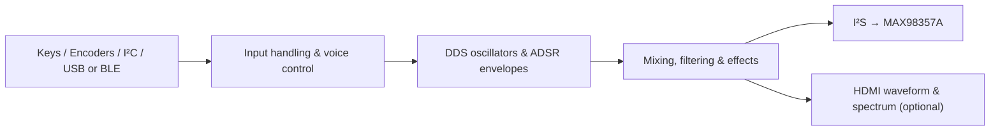

<div align="center">

# BeatIt · Tang Nano 20K

**A real-time FPGA music synthesizer and performance instrument**

[**English**](README.md) · [简体中文](README.zh-CN.md)


</div>

BeatIt is an FPGA-based electronic instrument built for the [Sipeed Tang Nano 20K](https://wiki.sipeed.com/hardware/en/tang/tang-nano-20k/nano-20k.html). Its Verilog audio engine generates, envelopes, processes and mixes samples directly on the FPGA, rather than playing prerecorded tracks. A companion Android app adds a touch keyboard, MIDI playback and guided practice over Bluetooth Low Energy (BLE).

## Features

| Area | Implementation |
| --- | --- |
| **Real-time synthesis** | Up to 32 voices; two independently tuned and enveloped DDS oscillators per voice; monophonic legato mode |
| **Sound processing** | Fixed-point mixing, live waveform changes, tone filtering, tremolo, delay and reverb; I²S audio output |
| **Instrument controls** | Physical keys and rotary encoders; optional I²C expression inputs and illuminated keys |
| **Display and connectivity** | Optional 640 × 480 HDMI waveform and 32-bin spectrum; USB UART or BLE UART control; Android MIDI import and performance recording |

The supported features depend on the selected firmware build profile and attached peripherals. The 32-voice configuration is an available build option, not a claim that every hardware configuration has been validated.

## System overview



Audio generation is implemented in FPGA RTL. The Android app exchanges control and status messages with the instrument; it is not an audio-rendering backend.

## Repository layout

| Path | Purpose |
| --- | --- |
| `rtl/` | Verilog top-level, audio, control and video modules; ROM data |
| `constraints/` | Gowin pin assignments and timing constraints |
| `scripts/` | Build, programming, serial control and ROM-generation utilities |
| `sim/` | RTL testbenches and host-side tests |
| `android_app/` | Android application, Gradle wrapper and [UART/BLE protocol](android_app/docs/protocol-v1.en.md) |
| `docs/` | DDS note table and supporting technical data |
| `licenses/` | Licenses for separately distributed components |

## Quick start

### 1. Build the FPGA bitstream

**Requirements:** Windows, Python 3.10+, and Gowin EDA. Set `GOWIN_HOME` to the installation directory containing `IDE/bin/gw_sh.exe`.

For an initial bench build without external controls:

```console
python scripts/build_gowin.py --app --transport usb --voices 4 --performance --no-controls
```

For the BLE instrument profile with external peripherals and HDMI:

```console
python scripts/build_gowin.py --app --transport ble --voices 32 --performance --peripherals --guide --mono --tremolo --delay --reverb --dc-block --hdmi --placement-opt
```

Build outputs, timing reports and the manifest are written under `build/`. The project profile expects a 49.152 MHz audio clock. Choose the constraints that match the transport and attached peripherals.

The BLE profile uses an external 3.3 V UART module supporting Nordic UART Service (NUS) or HM-10-style UART at 115200 baud. If Windows temporary paths are long or contain non-ASCII characters, set `BEATIT_STAGE_DIR` to a short ASCII-only path such as `C:\fpga-temp`.

### 2. Program the board

Install host-side dependencies:

```console
python -m pip install -r requirements.txt
```

For SRAM programming, set `GOWIN_PROGRAMMER_HOME` to a Gowin Programmer 1.9.12.04 or later installation, then locate the cable:

```console
python scripts/program_sram.py --list
```

Use the corresponding build-profile flags together with `--location` and `--verify` for programming. Expression calibration is disabled in the neutral boot profile until configured for the board.

### 3. Run simulations and tests

Install Icarus Verilog and put `iverilog` and `vvp` on `PATH`.

```console
python scripts/run_tests.py tb_adsr tb_i2c_peripherals tb_performance_bridge tb_hdmi_spectrum tb_video_timing
python -m unittest sim.test_device_protocol sim.test_guide_protocol sim.test_hdmi_build sim.test_flash_guard
```

Running `python scripts/run_tests.py` without test names also exercises configurations using Gowin's simulation models from `GOWIN_HOME`.

### 4. Build the Android app

Install JDK 17+ and Android SDK 36. Configure `JAVA_HOME` and `ANDROID_HOME`, or open `android_app/` in Android Studio.

```console
cd android_app
./gradlew assembleDebug lintDebug
```

On Windows, run `.\gradlew.bat assembleDebug lintDebug`. The app supports Android 8.0 and later. Use a compatible BLE FPGA build for wireless instrument control.

## Documentation and contributing

- [UART / BLE protocol v1](android_app/docs/protocol-v1.en.md) · [简体中文版](android_app/docs/protocol-v1.md)
- [Contributing guide](CONTRIBUTING.md) · [中文贡献指南](CONTRIBUTING.zh-CN.md)
- [Third-party notices](THIRD_PARTY_NOTICES.md) · [中文说明](THIRD_PARTY_NOTICES.zh-CN.md)

## License

Project-owned materials are provided under the **[BeatIt Project License](LICENSE)**, which includes attribution requirements for commercial use and substantial reuse. This is a project-specific license, not the MIT license. Separately licensed components are listed in the [third-party notices](THIRD_PARTY_NOTICES.md). Refer to the license files for the governing terms.
