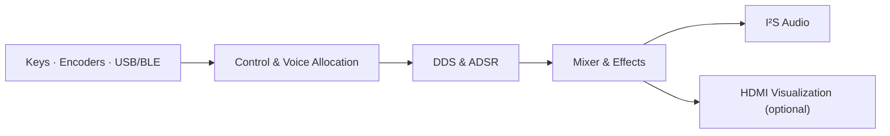

<div align="center">

# BeatIt · Tang Nano 20K

**Real-time FPGA Music Synthesizer**

**English** · [简体中文](README.zh-CN.md)


</div>

BeatIt is a real-time electronic instrument built around the **Sipeed Tang Nano 20K**. Its Verilog RTL generates and processes audio directly on the FPGA. An optional Android app provides BLE control, a touch keyboard, MIDI playback, and guided practice.

## Features

- **Synthesis:** Configurable polyphony (up to 32 voices), two DDS oscillators per voice, ADSR envelopes, and real-time pitch control.
- **Audio:** Fixed-point mixing, waveform selection, filtering, tremolo, delay, reverb, and I²S output.
- **Interaction:** Physical keys, rotary encoders, optional I²C expression controls and illuminated keys.
- **Integration:** USB/BLE UART, optional HDMI waveform and spectrum display, companion Android app.

Features and achievable voice counts depend on the selected build profile and connected hardware.

## Architecture



Audio samples are generated on the FPGA; the Android app exchanges control and status data.

## Getting started

**FPGA requirements:** Windows, Python 3.10+, Gowin EDA, and `GOWIN_HOME` pointing to the Gowin installation containing `IDE/bin/gw_sh.exe`.

Basic USB bench build:

```bash
python scripts/build_gowin.py --app --transport usb --voices 4 --performance --no-controls
```

Extended BLE instrument build (requires matching peripherals and constraints):

```bash
python scripts/build_gowin.py --app --transport ble --voices 32 --performance --peripherals --guide --mono --tremolo --delay --reverb --dc-block --hdmi --placement-opt
```

Build outputs are saved under `build/`. For a host-side smoke test, install Icarus Verilog and run:

```bash
python scripts/run_tests.py tb_adsr tb_performance_bridge
```

For Android, use JDK 17+, Android SDK 36, and run `gradlew assembleDebug` from `android_app/` (use `gradlew.bat` on Windows).

## Repository structure

| Directory | Contents |
| --- | --- |
| `rtl/`, `constraints/` | RTL modules and FPGA constraints |
| `scripts/`, `sim/` | Build tools and tests |
| `android_app/` | Android application and [UART/BLE protocol](android_app/docs/protocol-v1.md) |
| `docs/`, `licenses/` | Supporting data and third-party license texts |

## License

Project-owned material is governed by the [BeatIt Project License](LICENSE), a **custom license** with attribution requirements for commercial use and substantial reuse. See [third-party notices](THIRD_PARTY_NOTICES.md) for separately licensed components.
