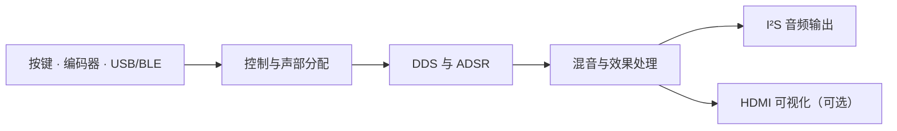

<div align="center">

# BeatIt · Tang Nano 20K

**基于 FPGA 的实时音乐合成电子乐器**

[English](README.md) · **简体中文**


</div>

BeatIt 是基于 **Sipeed Tang Nano 20K** 的实时电子乐器项目。Verilog RTL 在 FPGA 内部直接生成并处理音频；可选 Android 应用通过低功耗蓝牙（BLE）提供触屏琴键、MIDI 播放和跟弹练习功能。

## 主要功能

- **音频合成：** 可配置复音（最多 32 声部）、每声部双 DDS 振荡器、ADSR 包络和实时变调。
- **声音处理：** 定点混音、波形切换、滤波、颤音、延迟、混响及 I²S 输出。
- **演奏交互：** 实体按键、旋转编码器，以及可选的 I²C 表情控制和琴键指示灯。
- **设备联动：** USB/BLE UART、可选 HDMI 波形与频谱显示、配套 Android 应用。

具体可用功能及复音规模取决于构建配置和连接的硬件外设。

## 系统架构



音频样本由 FPGA 生成；Android 应用只负责控制指令及状态数据的交换。

## 快速开始

**FPGA 环境：** Windows、Python 3.10+、Gowin EDA，并将 `GOWIN_HOME` 指向包含 `IDE/bin/gw_sh.exe` 的 Gowin 安装目录。

基础 USB 测试配置：

```bash
python scripts/build_gowin.py --app --transport usb --voices 4 --performance --no-controls
```

扩展 BLE 乐器配置（需匹配外设及约束文件）：

```bash
python scripts/build_gowin.py --app --transport ble --voices 32 --performance --peripherals --guide --mono --tremolo --delay --reverb --dc-block --hdmi --placement-opt
```

构建产物位于 `build/`。安装 Icarus Verilog 后，可运行基本仿真检查：

```bash
python scripts/run_tests.py tb_adsr tb_performance_bridge
```

Android 应用需要 JDK 17+ 和 Android SDK 36。在 `android_app/` 目录执行 `gradlew assembleDebug`，Windows 使用 `gradlew.bat`。

## 仓库结构

| 目录 | 内容 |
| --- | --- |
| `rtl/`、`constraints/` | RTL 模块与 FPGA 约束 |
| `scripts/`、`sim/` | 构建工具及测试 |
| `android_app/` | Android 应用及 [UART/BLE 通信协议](android_app/docs/protocol-v1.md) |
| `docs/`、`licenses/` | 辅助数据及第三方许可证文本 |

## 许可协议

项目自有材料采用 [BeatIt Project License](LICENSE)，属于**自定义许可证**，对商业使用和大比例复用设有署名要求。第三方组件的授权情况详见[来源说明](THIRD_PARTY_NOTICES.md)。
