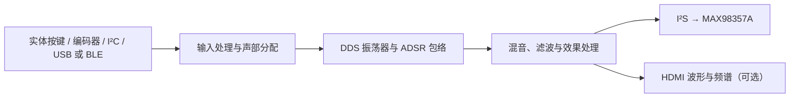

<div align="center">

# BeatIt · Tang Nano 20K

**基于 FPGA 的实时音乐合成与交互式电子乐器**

[English](README.md) · [**简体中文**](README.zh-CN.md)


</div>

BeatIt 是运行于 [Sipeed Tang Nano 20K](https://wiki.sipeed.com/hardware/en/tang/tang-nano-20k/nano-20k.html) 开发板的 FPGA 电子乐器项目。Verilog 音频引擎在 FPGA 内部逐样本完成声音生成、包络控制、音频处理与混音，不依赖预录曲目播放。配套 Android 应用通过低功耗蓝牙（BLE）提供触屏琴键、MIDI 文件播放与跟弹练习功能。

## 主要功能

| 模块 | 功能 |
| --- | --- |
| **实时音频合成** | 最多 32 声部；每声部包含两个可独立调音并控制包络的 DDS 振荡器；支持单音连奏模式 |
| **声音处理** | 定点混音、实时波形切换、音色滤波、颤音、延迟与混响；通过 I²S 输出 |
| **乐器交互** | 实体按键与旋转编码器；可选 I²C 表情控制输入及琴键指示灯 |
| **显示与连接** | 可选 640 × 480 HDMI 实时波形与 32 频带频谱；USB UART / BLE UART 控制；Android MIDI 导入与演奏录制 |

具体功能取决于所选固件构建配置和外接设备。32 声部是可选构建规模，不表示所有硬件组合均已完成实机验证。

## 系统架构



音频生成通路由 FPGA RTL 实现。Android 应用负责交换控制指令与设备状态，不承担 FPGA 音频引擎的声音渲染。

## 仓库结构

| 目录 | 内容 |
| --- | --- |
| `rtl/` | Verilog 顶层模块、音频与控制逻辑、视频逻辑、ROM 数据 |
| `constraints/` | Gowin 引脚分配与时序约束 |
| `scripts/` | 构建、下载、串口控制和 ROM 数据生成工具 |
| `sim/` | RTL 仿真测试平台与主机侧测试 |
| `android_app/` | Android 应用、Gradle Wrapper 及 [UART/BLE 通信协议](android_app/docs/protocol-v1.md) |
| `docs/` | DDS 音符查找表及相关技术资料 |
| `licenses/` | 随附第三方组件的许可证文本 |

## 快速开始

### 1. 构建 FPGA 位流

**环境要求：** Windows、Python 3.10 及以上版本、Gowin EDA。将 `GOWIN_HOME` 设置为包含 `IDE/bin/gw_sh.exe` 的安装目录。

首先构建不依赖外接控制设备的 USB 测试配置：

```console
python scripts/build_gowin.py --app --transport usb --voices 4 --performance --no-controls
```

如需 BLE 乐器配置及外设、HDMI 功能：

```console
python scripts/build_gowin.py --app --transport ble --voices 32 --performance --peripherals --guide --mono --tremolo --delay --reverb --dc-block --hdmi --placement-opt
```

位流、时序报告和构建清单输出至 `build/`。项目构建配置预期使用 49.152 MHz 音频时钟，应按实际控制链路及外接设备选择匹配的约束文件。

BLE 配置需要外接 3.3 V UART 模块，支持 Nordic UART Service（NUS）或 HM-10 风格 UART，波特率为 115200。若 Windows 临时目录路径过长或包含非 ASCII 字符，可将 `BEATIT_STAGE_DIR` 设置为 `C:\fpga-temp` 等较短路径。

### 2. 下载至开发板

安装主机侧依赖：

```console
python -m pip install -r requirements.txt
```

SRAM 下载需配置 `GOWIN_PROGRAMMER_HOME`，指向 Gowin Programmer 1.9.12.04 或更高版本的安装位置。首先查看下载线：

```console
python scripts/program_sram.py --list
```

下载时使用与构建一致的配置参数，并指定 `--location` 与 `--verify`。中性启动配置默认关闭表情控制校准，需根据开发板完成相应配置后使用。

### 3. 运行仿真和测试

安装 Icarus Verilog，并将 `iverilog`、`vvp` 加入系统 `PATH`。

```console
python scripts/run_tests.py tb_adsr tb_i2c_peripherals tb_performance_bridge tb_hdmi_spectrum tb_video_timing
python -m unittest sim.test_device_protocol sim.test_guide_protocol sim.test_hdmi_build sim.test_flash_guard
```

不传测试名称直接运行 `python scripts/run_tests.py` 时，还将执行依赖 `GOWIN_HOME` 下 Gowin 仿真模型的配置。

### 4. 构建 Android 应用

安装 JDK 17 及以上版本和 Android SDK 36。配置 `JAVA_HOME`、`ANDROID_HOME`，或直接在 Android Studio 中打开 `android_app/`。

```console
cd android_app
./gradlew assembleDebug lintDebug
```

Windows 平台使用 `.\gradlew.bat assembleDebug lintDebug`。应用支持 Android 8.0 及更高版本；通过蓝牙控制乐器时应使用兼容的 FPGA BLE 构建配置。

## 文档与参与开发

- [UART / BLE 协议 v1](android_app/docs/protocol-v1.md) · [English](android_app/docs/protocol-v1.en.md)
- [中文贡献指南](CONTRIBUTING.zh-CN.md) · [Contributing Guide](CONTRIBUTING.md)
- [第三方组件及来源说明](THIRD_PARTY_NOTICES.zh-CN.md) · [English](THIRD_PARTY_NOTICES.md)

## 许可协议

项目自有材料采用 **[BeatIt Project License](LICENSE)**，对商业使用及大比例代码复用设有署名要求。该协议是项目自定义许可证，**并非 MIT 协议**。随附第三方组件按各自许可证授权，详见[第三方来源说明](THIRD_PARTY_NOTICES.zh-CN.md)。具体权利义务以原始许可文本为准。
